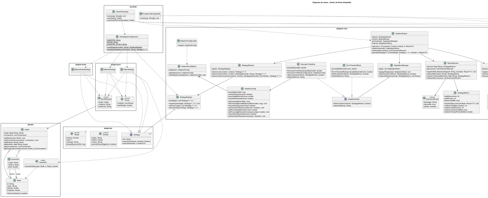
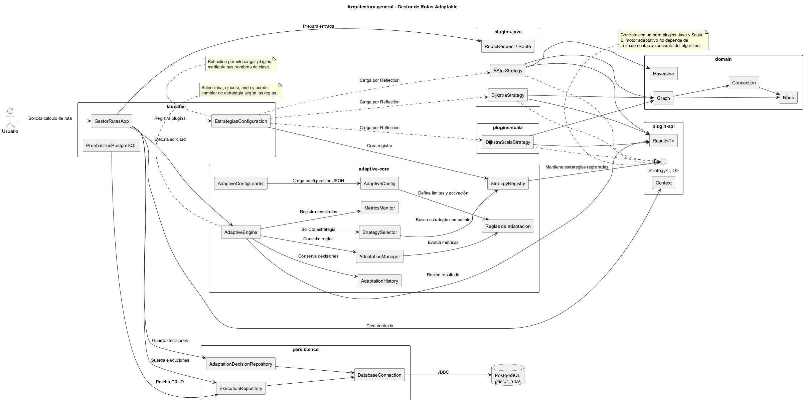

# Gestor de Rutas Adaptable

Proyecto académico individual de Ingeniería de Software que implementa un sistema de búsqueda de rutas con selección y adaptación automática de estrategias.

El sistema utiliza una arquitectura modular con Java y Scala. Permite registrar estrategias, evaluar su rendimiento y cambiar de algoritmo según las condiciones de ejecución.

## Tecnologías utilizadas

- Java 21.
- Scala.
- Maven.
- PostgreSQL.
- JDBC.
- JSON para la configuración.
- Reflection de Java para la carga dinámica de estrategias.
- JUnit para pruebas automatizadas.
- Doxygen y PlantUML para documentación y diagramas.

## Estructura del proyecto

| Módulo | Responsabilidad |
|---|---|
| `plugin-api` | Contrato común de las estrategias. |
| `domain` | Modelo del dominio y grafos. |
| `adaptive-core` | Selección, monitorización y adaptación automática. |
| `plugins-java` | Estrategias implementadas en Java. |
| `plugins-scala` | Estrategia implementada en Scala. |
| `persistence` | Conexión y operaciones con PostgreSQL. |
| `launcher` | Aplicación principal y demostraciones. |

## Requisitos previos

- JDK 21.
- PostgreSQL.
- Git.
- Doxygen (para generar la documentación técnica).

No es necesario instalar Maven por separado porque el proyecto incluye Maven Wrapper.

## Configuración de PostgreSQL

1. Instalar y ejecutar PostgreSQL.
2. Crear una base de datos para el proyecto.
3. Ejecutar el script `db/schema.sql` sobre esa base de datos.
4. Configurar los datos de conexión utilizados por `DatabaseConnection`.
5. Definir la variable de entorno `GESTOR_RUTAS_DB_PASSWORD` con la contraseña local de PostgreSQL.

El archivo `.env.example` muestra el nombre de la variable requerida. No contiene credenciales reales.

**Importante:** no subir contraseñas ni credenciales personales a GitHub.

## Compilación y pruebas

Desde la carpeta raíz del proyecto:

En Windows:

```powershell
.\mvnw.cmd clean verify
```

En Linux o macOS:

```bash
./mvnw clean verify
```

Para ejecutar las pruebas automatizadas:

```powershell
.\mvnw.cmd test
```

## Ejecución de la aplicación

En Windows:

```powershell
.\mvnw.cmd -pl launcher exec:java "-Dexec.mainClass=edu.utp.gestorrutas.launcher.GestorRutasApp"
```

También se puede ejecutar la clase `GestorRutasApp` desde IntelliJ IDEA, configurando previamente la variable de entorno `GESTOR_RUTAS_DB_PASSWORD`.

## Escenarios de demostración

El proyecto contempla escenarios para comprobar el comportamiento adaptativo:

1. **Adaptación por tiempo:** el sistema evalúa el tiempo de ejecución y puede seleccionar otra estrategia cuando se supera el umbral configurado.
2. **Adaptación por errores:** el motor detecta errores y puede cambiar automáticamente a una estrategia alternativa.
3. **Interoperabilidad Java–Scala:** se utiliza una estrategia implementada en Scala mediante el contrato común de estrategias.

En las pruebas realizadas se ha comprobado el cambio automático de Dijkstra implementado en Java a Dijkstra implementado en Scala.

## Demostración CRUD de PostgreSQL

El proyecto incluye la clase `PruebaCrudPostgreSQL`, ubicada en el módulo `launcher`.

Para ejecutarla en Windows:

```powershell
.\mvnw.cmd -pl launcher exec:java "-Dexec.mainClass=edu.utp.gestorrutas.launcher.PruebaCrudPostgreSQL"
```

Esta demostración permite comprobar las operaciones:

- **Create:** insertar un registro.
- **Read:** consultar registros.
- **Update:** actualizar un registro.
- **Delete:** eliminar un registro.

Es necesario tener PostgreSQL disponible y la conexión correctamente configurada.

## Documentación técnica

El proyecto utiliza Doxygen para generar documentación HTML a partir de los comentarios del código fuente Java.

Para generarla:

```powershell
doxygen .\Doxyfile
```

La documentación se genera en:

```text
docs/doxygen/html/
```

Para abrirla en Windows:

```powershell
Start-Process .\docs\doxygen\html\index.html
```

La configuración actual documenta los módulos Java. Los archivos HTML generados se excluyen del repositorio mediante `.gitignore`.

## Diagramas UML

Los diagramas se encuentran en `docs/diagrams/`.

### Diagrama de clases



### Diagrama de arquitectura



Los archivos `.puml` permiten editar y regenerar los diagramas mediante PlantUML.

## Estado del desarrollo

- [x] Configuración del entorno de desarrollo.
- [x] Estructura modular Maven.
- [x] API y contrato de estrategias.
- [x] Modelo del dominio y grafos.
- [x] Algoritmos de búsqueda en Java.
- [x] Estrategia adicional en Scala.
- [x] Registro y selección de estrategias.
- [x] Carga dinámica mediante Reflection.
- [x] Motor de adaptación automática.
- [x] Monitorización de métricas.
- [x] Reglas de adaptación por tiempo y errores.
- [x] Configuración mediante JSON.
- [x] Integración con PostgreSQL.
- [x] Operaciones CRUD.
- [x] Registro de decisiones adaptativas.
- [x] Pruebas de compilación y verificación Maven.
- [x] Diagramas UML.
- [x] Configuración de Doxygen.
- [ ] Auditoría final de todos los requisitos de la rúbrica.

## Repositorio

GitHub: https://github.com/Billoqui/GestorRutas

---

**Proyecto académico individual — Ingeniería de Software**

Desarrollado para aplicar programación orientada a objetos, arquitectura modular, interoperabilidad Java–Scala, selección adaptativa de algoritmos y persistencia de información.
